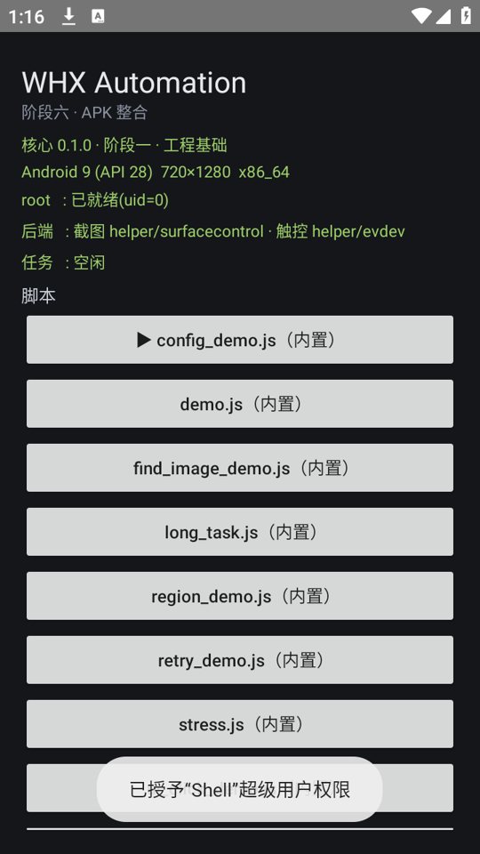
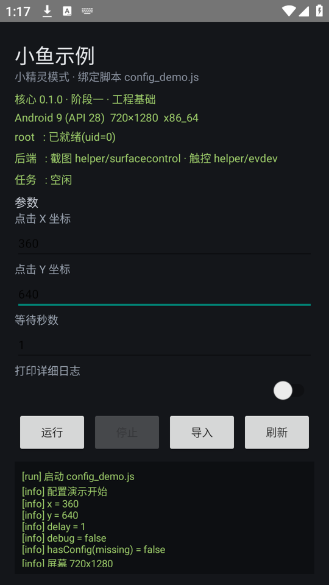
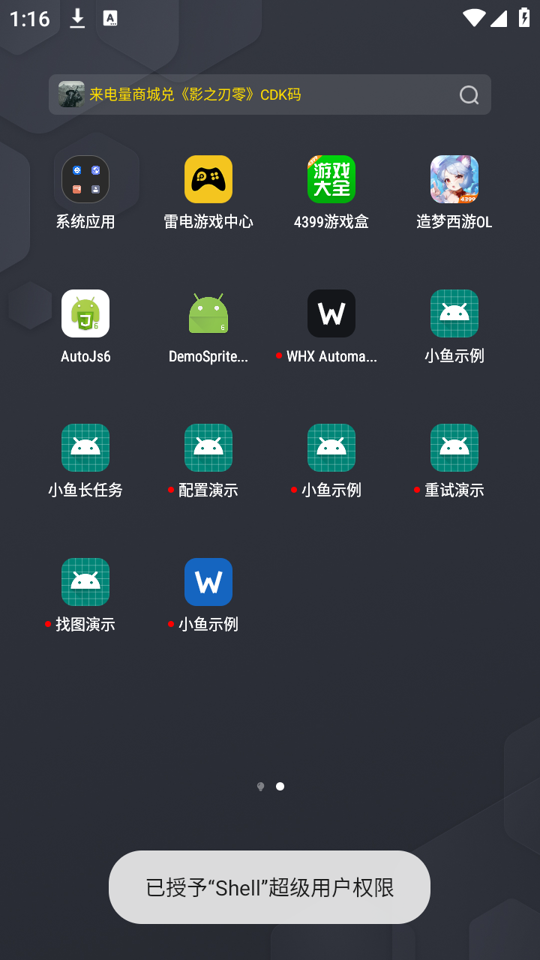

# WHX Automation


> Android 自动化运行平台：**PC 上开发，Android 上运行，可打包成独立 APK 脱离 PC 执行**。
> 全部自研，不复刻任何现有工具的实现。

**当前状态：阶段二十一 完成**（无障碍支持 findId／点击整行／滚动查找）。剩余：ARM64 云手机/真机验证。

📄 最高依据：[项目书](docs/project-charter.md) —— 本文档集与项目书冲突时，以项目书为准。

## 定位

不是手机端编程软件，而是**通过 JavaScript 控制 Android 设备的自动化运行平台**。

- 开发全在 PC：脚本编写、调试、测试、APK 构建
- Android 只跑：导入、选择、启动、看日志，**不提供编辑功能**
- 引擎独立于界面，方便后续复用
- 最终产物可打包成独立 APK，安装后无需 PC

## 架构（一个 APK，两段进程）

```
PC 开发环境
  VS Code / Android Studio · 脚本编写调试 · APK 构建
                    │  TCP 7911（adb forward）
                    ▼
┌── Android APK ───────────────────────────────┐
│ Automation App（uid=10xxx）                  │
│   权限管理 · 任务启动 · 运行状态 · 日志       │
│                                              │
│ Automation Core（同进程内，独立模块）         │
│   截图引擎 · 图像识别 · 触控调度              │
│   QuickJS · JavaScript API · 任务生命周期     │
└───────────────┬──────────────────────────────┘
                │ LocalSocket（约 0.1~0.3ms）
┌───────────────▼──────────────────────────────┐
│ Root Helper（uid=0，APK 自带、由 su 拉起）     │
│   SurfaceControl 截图 · evdev 注入 · root sh  │
└──────────────────────────────────────────────┘
                ▼
        模拟器 / 云手机 / 真机
```

**为什么需要 helper 子进程**：实测确认，普通应用进程拿不到 `READ_FRAME_BUFFER` 权限，
`SurfaceControl` 截图会失败；写 `/dev/input/*` 也必须有 root。所以把**纯硬件操作**
隔离到一个最小的 root 进程。它仍是同一个 APK 的一部分，不增加交付物。

## 技术栈

| 技术 | 用途 |
| --- | --- |
| Java | Android 应用与自动化核心 |
| JavaScript | 用户脚本 |
| QuickJS | Android 端 JS 引擎（支持 async/await） |
| Kotlin | 不使用（项目书指定 Java） |
| C++ / JNI | 仅当图像处理被证明是瓶颈时引入 |
| Gradle + Android SDK | 构建 |

## 目录（规划，尚未创建）

```
whx-automation/
├─ app/              Automation App：权限 / 任务 / 状态 / 日志 / 服务
├─ core/             Automation Core：截图 / 识别 / 触控 / QuickJS / API
├─ helper/           Root Helper：纯 Java，打进 APK，由 su 拉起
├─ tools/            PC 端命令行：部署 / 调试 / 打包
├─ packer/           小精灵打包：壳 + 脚本 → 独立 APK
├─ examples/         示例脚本
├─ sdk/              TypeScript 类型定义（编辑器补全）
├─ assets/           模板图库
└─ docs/             项目书、架构、协议、API、路线、环境
```

## 里程碑（对齐项目书第九节）

| 阶段 | 内容 | 交付成果 |
| --- | --- | --- |
| **〇**（当前） | 立项：项目书、架构、协议、API、路线 | 本目录文档 |
| 一 · 工程基础 | Android Studio / SDK / NDK / CMake / Git / 首个 APK | 模拟器上能跑的 APK |
| 二 · 截图引擎 | 截图、连续截图、区域截图、缓存、耗时与内存测量 | 可独立测试的截图模块 |
| 三 · 图像识别 | 取色、颜色判断、单点/多点找色、相似色、扫描优化 | 可用的识别模块 |
| 四 · 触控引擎 | 点击、长按、滑动、手势、多后端研究 | 能独立执行触控 |
| 五 · 脚本引擎 | QuickJS 集成、Java 桥、基础 API、运行/停止、日志异常 | APK 能跑 PC 写的脚本 |
| 六 · APK 整合 | 任务管理、脚本导入、内置脚本、状态界面 | 第一版完整 APK |
| 七 · 跨架构 | x86_64 / ARM64 云手机 / ARM64 真机验证 | 跨架构版本 |
| 八 · 优化扩展 | 识别提速、资源管理、内存、长期稳定性 | 正式版本 |

验收标准与实测基线见 [docs/roadmap.md](docs/roadmap.md)。

## 已完成的实测（2026-10-30，雷电 9 / Android 9 / 720×1280）

这些数字不是估算，是这台机器上跑出来的，用于校正后续所有性能目标：

| 项 | 结果 |
| --- | --- |
| 进程内 `SurfaceControl` 截图 720p | **11.4ms**（合成 3.5 + 硬件位图回读 5.7 + 拷像素 2.3） |
| 9 条 evdev 事件写入 | **0.033ms** |
| 完整 tap（按住 30ms） | **31.3ms** |
| 对照：`adb exec-out screencap` | 141.6ms |
| 对照：`input tap` | 134.6ms |

顺带确认的三个环境事实：

1. 雷电 9 **没有任何 framebuffer 节点**（`/dev/fb0` 不存在）→ 截图只能走 SurfaceControl
2. `SurfaceControl.screenshot` 返回 **HARDWARE bitmap**，`getPixels()` 会直接抛异常，必须先回读
3. 触摸轴是横屏坐标（`轴X=屏幕y`、`轴Y=屏幕x`），不交换就点偏且不报错

## PC 端工具链

```bash
python tools/whx.py devices                      # 设备/root/分辨率
python tools/whx.py run demo.js                  # 推脚本 → 运行 → 跟日志
python tools/whx.py run a.js b.js c.js            # 任务链：顺序执行，失败即停
python tools/whx.py watch dist/my.js             # 监听改动，存盘即跑
python tools/whx.py schedule add demo.js --time 08:30   # 设备端定时
python tools/whx.py history                     # 最近运行结果（成败/耗时/错误）
python tools/whx.py ui enable                   # 启用无障碍（脚本读界面文字）
python tools/vision_cli.py template --tpl t.png  # PC 上验证找图命中位置
python tools/whx.py shot dist/a.png              # 截图到 PC
python tools/whx.py pack demo.js --label 小鱼 --pkg com.whx.sprite.demo
```

脚本失败时退出码为 1，可直接接 CI。详见 [docs/cli.md](docs/cli.md)。

## 界面

| 主应用（脚本管理） | 小精灵（独立分发） | 桌面图标 |
| --- | --- | --- |
|  |  |  |

主应用负责导入/选择/运行/看日志；小精灵是打包后的成品，带自己的名字、图标与参数输入框，
使用者不需要 PC，也不需要看代码。

## 构建与运行

```bash
# 依赖：JDK 17+（本机 21）、Android SDK（platform 34 + build-tools 34）、Gradle 用仓库自带 wrapper
./gradlew assembleDebug                 # 开发包（夹带调试信息）
./gradlew assembleRelease               # 发布包（R8 优化，桥接快 ~10×）
adb install -r app/build/outputs/apk/debug/app-debug.apk

# 单元测试（纯 JVM，不需要设备）
./gradlew :core:test :helper:test

# 打包成独立小精灵（0.77 秒）
python packer/make_sprite.py     --shell app/build/outputs/apk/debug/app-debug.apk     --script app/src/main/assets/scripts/demo.js     --label "小鱼示例" --pkg com.whx.sprite.demo     --out dist/xiaoyu-demo.apk
```

> 构建依赖走阿里云镜像（本机直连 Maven Central 的 TLS 会被中断），见 `settings.gradle` 注释。

## 环境

JDK 21 ✅、Android SDK ✅（`D:\Android\Sdk`）、adb ✅、雷电模拟器 9 ✅（root 可用）。
待装：NDK / CMake（阶段一）。详见 [docs/environment.md](docs/environment.md)。

## 免责

仅用于自有设备、自有应用的自动化与测试。遵守目标平台的服务条款。
